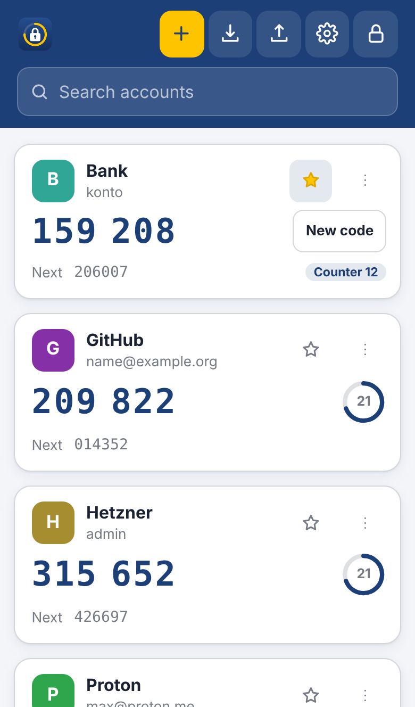
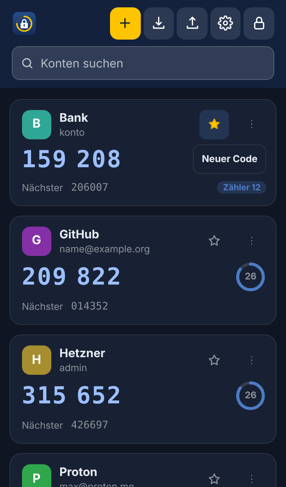
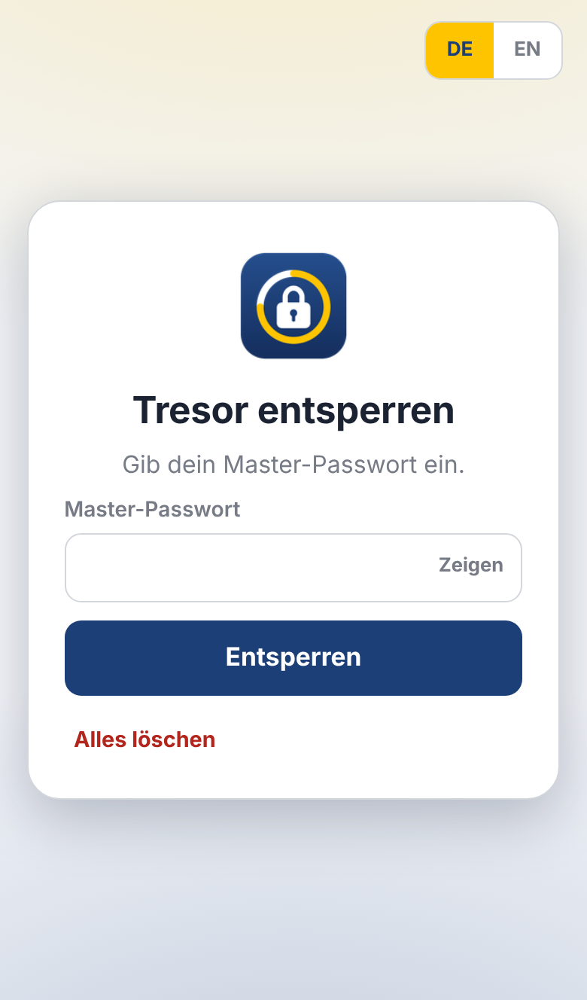
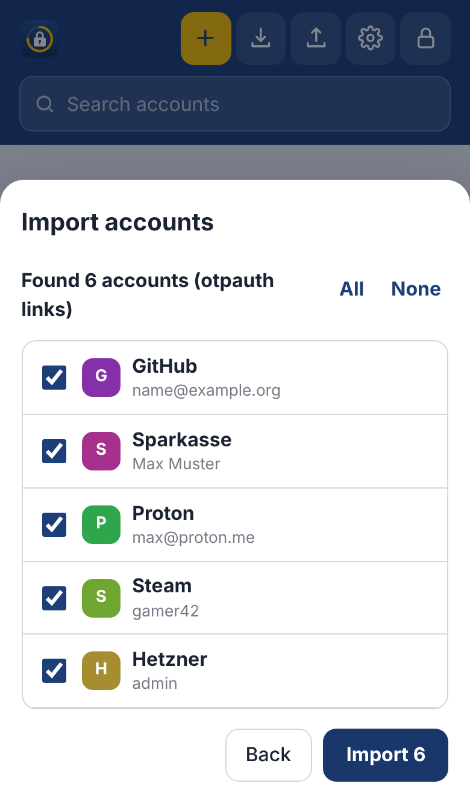
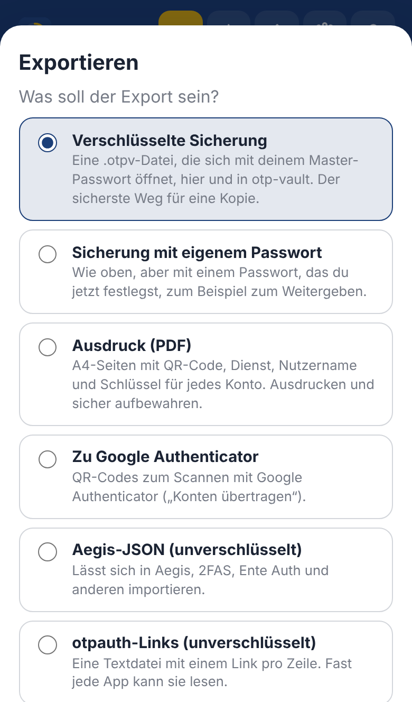
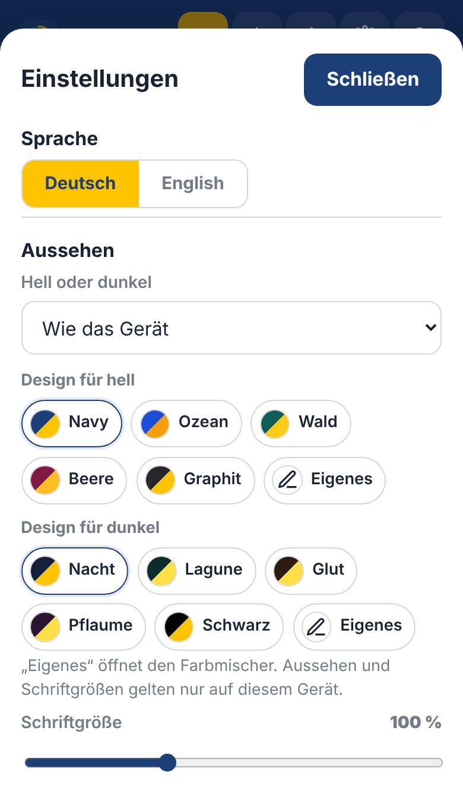

<div align="center">


# OTP-PWA

[Deutsch](README.md) · **English**

### Your two-factor codes as an app on your phone, encrypted and entirely on the device

**The little brother of [otp-vault](https://github.com/burnersen/otp-vault).** Your own web space only shows the instructions "how to install the app". Once added to the Home Screen, everything runs on the phone only, even offline. Same vault format as otp-vault, the same imports and exports, plus Face ID.

[](#requirements)
[](#on-the-phone)
[](#license)
[](https://ko-fi.com/burnersen)

**[⬇️ Download the latest release](../../releases/latest)** · **[☕ Buy me a coffee](https://ko-fi.com/burnersen)**

 

<sub>Made-up sample accounts.</sub>

</div>

## Contents

[What it does](#what-it-does) · [Requirements](#requirements) · [Installation](#installation) · [On the phone](#on-the-phone) · [Backup and restore](#backup-and-restore) · [Does it stay on the phone?](#does-it-stay-on-the-phone) · [Security](#security) · [Updating](#updating) · [Structure](#structure) · [License](#license)

## What it does

- **All codes at a glance:** big, readable codes with a countdown ring and the next code below. TOTP, HOTP and Steam, SHA1, SHA256 and SHA512, 6 to 8 digits, any period. Tap to copy.
- **Entirely on the device:** the server only delivers the app; in the browser the page shows nothing but the installation instructions. Vault, key and accounts never leave the phone. There is no account, no login and no server password, only your master password in the app.
- **Face ID or fingerprint:** if you like, Face ID unlocks the vault. Not just a checkbox: through a passkey (WebAuthn with PRF) Face ID releases a secret that encrypts the vault key. The master password keeps working.
- **Import from almost anything:** QR codes straight from the camera (several in a row for the Google export), pictures and screenshots, otpauth links, a bare secret, Google Authenticator export, Aegis (also encrypted), 2FAS (also encrypted), andOTP, Bitwarden (JSON and CSV), KeePassXC CSV, any CSV with a secret column, otp-vault backups. Duplicates are recognised.
- **Export in every direction:** encrypted backup (with the master password or its own), A4 recovery sheet as PDF with QR codes, QR codes for Google Authenticator, Aegis JSON, otpauth links, CSV. On iPhone the file goes through "Share" straight to Files, iCloud, AirDrop or Mail.
- **Icons of the services:** when adding and importing, the app fetches the icon from the website of the service (through your own server, which only learns the name of the website). If the website does not fit, enter it yourself or choose an image or photo. Can be switched off; "Fetch missing icons" does all at once.
- **Same format as otp-vault:** a backup from here opens in otp-vault on Windows and the other way round. Checked with real Go code.
- **Ten designs and your own colours:** five light, five dark, plus one custom each from the colour mixer (hue, saturation, lightness, colour picker or colour code, with preview). Light and dark like the device or fixed. Font size and code size adjustable, compact list if you like.
- **Reminds you to back up** when something changed since the last backup (interval adjustable).
- **Locks itself** after a while without use and when the app goes to the background (both adjustable). Leaving the app blurs the codes.
- **Updates itself:** the server fetches new versions from the GitHub release once a day (with checksum), the phones switch after a tap.
- **German and English.**

<table>
  <tr>
    <td align="center" width="25%"><br><sub>Unlock</sub></td>
    <td align="center" width="25%"><br><sub>Import with preview</sub></td>
    <td align="center" width="25%"><br><sub>Export</sub></td>
    <td align="center" width="25%"><br><sub>Settings</sub></td>
  </tr>
</table>

## Requirements

- Web space or a server with **PHP 7.4 or newer**. No database, no extensions needed.
- **HTTPS with your own domain** (Let's Encrypt is fine). Without HTTPS there is no Home Screen app, no offline and no Face ID.
- For automatic updates also: `curl` or `allow_url_fopen`, and PHP must be allowed to overwrite the program files. Without that everything still works, updates are then done by hand.
- For icons from the websites: `curl`. Without it only your own images work.
- On the phone: iPhone with iOS 16.4 or newer (Face ID from iOS 18), Android with Chrome. On a computer any current browser works.

## Installation

1. Download `otp-pwa-install.php` from the [latest release](../../releases/latest) and copy it to a folder on your web space, for example `https://your-domain.com/otp/`.
2. PHP must be allowed to write to this folder (it creates `index.php` and the folder `app/` there, later `data/`).
3. Open `otp-pwa-install.php` in the browser and tap "Install now". The file unpacks the program and deletes itself afterwards. If it reports that this failed, please delete it by hand.
4. **Check that the internal folders are locked:** `https://your-domain.com/otp/app/lib/common.php` and `https://your-domain.com/otp/data/config.php` must show "403 Forbidden" or "404 Not Found". Under Apache and LiteSpeed the included `.htaccess` files do that. Under **nginx** add these lines to the `server` block (adjust the path):

```nginx
# OTP-PWA lives in the folder /otp/ here. If it is in the web root, leave out /otp.
location ^~ /otp/data/ { deny all; }
location ^~ /otp/app/  { deny all; }
```

```sh
# Back up the configuration (path depends on the system)
sudo cp -a /etc/nginx/sites-available/default /etc/nginx/sites-available/default.bak
# Test and reload
sudo nginx -t && sudo systemctl reload nginx
# If something goes wrong: restore and reload
sudo cp -a /etc/nginx/sites-available/default.bak /etc/nginx/sites-available/default && sudo systemctl reload nginx
```

OTP-PWA delivers everything in `app/` itself through `index.php`, direct access is never needed. Even if the lock is missing nothing secret is there: the server knows no accounts.

> **Plesk and other servers with nginx in front of Apache:** if "Serve static files directly by nginx" is on, nginx delivers files like `.txt`, `.html` or `.zip` past the `.htaccess`. Then either untick it or put the nginx lines above into "Additional nginx directives". Test: `https://your-domain.com/otp/data/index.html` must show "403", not an empty page (`data/` appears with the first update check).

**Prefer doing it by hand?** The release also has `otp-pwa-<version>.zip`. Upload the contents of the folder `otp-pwa/`, that is `index.php` **and** the folder `app/`, then continue with step 4.

There is no password for the server: the website accepts nothing and only shows the installation instructions in the browser.

## On the phone

In the browser the page only shows the instructions for your device. The program itself starts only as an installed app, so the vault never ends up in the browser by mistake.

**iPhone:** open the address in **Safari** (not in private mode), tap the Share icon, then "Add to Home Screen" and "Add". Start OTP-PWA from the Home Screen.

**Android:** open the address in Chrome, tap "Install app" (or "Install app" in the menu).

**Computer:** in Chrome or Edge click the install icon in the address bar, in Safari on the Mac "File" and "Add to Dock". Firefox cannot install apps.

Then: choose a master password, add accounts (scan the QR code with the camera, paste a link or secret) or import them. Turn on Face ID in the settings.

## Backup and restore

**Back up:** *Export* → "Encrypted backup" → "Create file" → "Share or save to Files". The `.otpv` file is encrypted with your master password (Argon2id and XChaCha20-Poly1305), exactly like otp-vault. Keep it in a safe place anyway, for example iCloud Drive or a USB stick. The app reminds you when a new backup is due.

**Restore on a new device:** open the page, install it as an app, tap "Restore from a backup" on the lock screen, choose the `.otpv` file and enter its password. Done. The password of the backup is your master password afterwards; you can change it in the settings.

**Into an existing vault:** *Import* → choose the file. That works with backups of OTP-PWA and otp-vault just like with exports of other apps.

**On paper:** the PDF recovery sheet has QR code, service, user name and secret for every account. Print it, keep it safe, delete the file.

## Does it stay on the phone?

Yes. A Home Screen app keeps its data and you are never logged out (there is no account). Safari's rule of deleting data after seven days without a visit does not apply to Home Screen apps. OTP-PWA also asks the browser for persistent storage; the settings show under *Storage* whether that worked.

The data is gone, however, if you delete the app from the Home Screen, choose "Clear website data", or the device cleans up when space is extremely low. **So: back up regularly.** If the server is ever down, the app on the phone simply keeps working.

## Security

- The vault is stored encrypted in the browser storage (IndexedDB), in otp-vault's file format: key from the master password with **Argon2id** (64 MiB, 3 passes), content with **XChaCha20-Poly1305**, the header is bound to the content. Nothing is readable without the password, not even the names of the accounts. The previous state is kept as a fallback.
- While unlocked, key and accounts are only in memory. Locking forgets both.
- **Face ID:** a passkey on the device releases a secret through the WebAuthn extension PRF after Face ID. That yields a key which encrypts the stored vault key. Nobody gets to it without Face ID. After a password change Face ID has to be turned on again.
- The app loads nothing from other servers and sends nothing away (strict Content Security Policy, `connect-src 'self'`). Connections only go to your own server: to look for a new version and, if switched on, to fetch icons. For an icon the server only learns the name of the website (for example `github.com`), never a secret or user name. It fetches only over HTTPS from public addresses, nothing from your internal network, at most 512 KB. On the device the icon is scaled to 96 × 96 pixels and stored encrypted in the vault.
- **What you have to trust the server with:** it delivers the program code. Someone who takes over the server could deliver a changed app. That is why the phones only switch to a new version after a tap on "Update", and the server only installs releases whose checksum matches. Keep the web space safe (hoster updates, strong passwords).
- The clipboard is cleared after the configured time if the device allows it. iPhone often does not.

## Updating

**On its own:** once a day the server looks at the GitHub release (triggered when an app asks for a new version). If there is a new one, it downloads the installer, checks its checksum and installs it. No button or password needed. Whether it worked is shown in the app under *Settings → About*.

The phones notice the new version the next time the app is opened and show "New version ready". A tap on "Update" loads it; unlock again afterwards. The vault is not touched.

**By hand:** upload the new `otp-pwa-install.php` and open it. Only the program files are replaced. That is also how you go back to an older version: upload its installer from the release and open it.

To switch updates off completely, add `'update_url' => ''` to `data/config.php` (otherwise the newest version comes back the next day).

## Structure

```
index.php      entry: delivers app, files, service worker and manifest (PHP)
app/lib/       helpers, automatic updates from the GitHub release, fetching icons (PHP)
app/views/     the app page (in the browser only the instructions, as an app the program)
app/assets/    the app in the browser: core.js (codes, formats, vault, PDF), app.js (interface), i18n.js (texts),
               app.css, sw.js (service worker), libraries (Argon2, XChaCha20, QR codes)
data/          created on the server, only for the state of the updates
tools/         checks (node tools/check.js) and release build (php tools/build-release.php)
```

No framework, no npm, no build step: what is in the repo runs. Checks:

```sh
node tools/check.js
for f in index.php app/lib/*.php app/views/*.php tools/*.php; do php -l "$f"; done
php tools/build-release.php
```

## ☕ Support

OTP-PWA is free and made in my spare time. If it saved you time, you can [drop a little something in the tip jar on Ko-fi](https://ko-fi.com/burnersen). Completely optional, and either way: thank you for using it!

## License

GNU General Public License v3.0, see [LICENSE](LICENSE). Included: [hash-wasm](https://github.com/Daninet/hash-wasm), [@noble/ciphers and @noble/hashes](https://paulmillr.com/noble/), [qrcode-generator](https://github.com/kazuhikoarase/qrcode-generator) (all MIT) and [jsQR](https://github.com/cozmo/jsQR) (Apache-2.0), see `app/assets/THIRD-PARTY-LICENSES.txt`.
