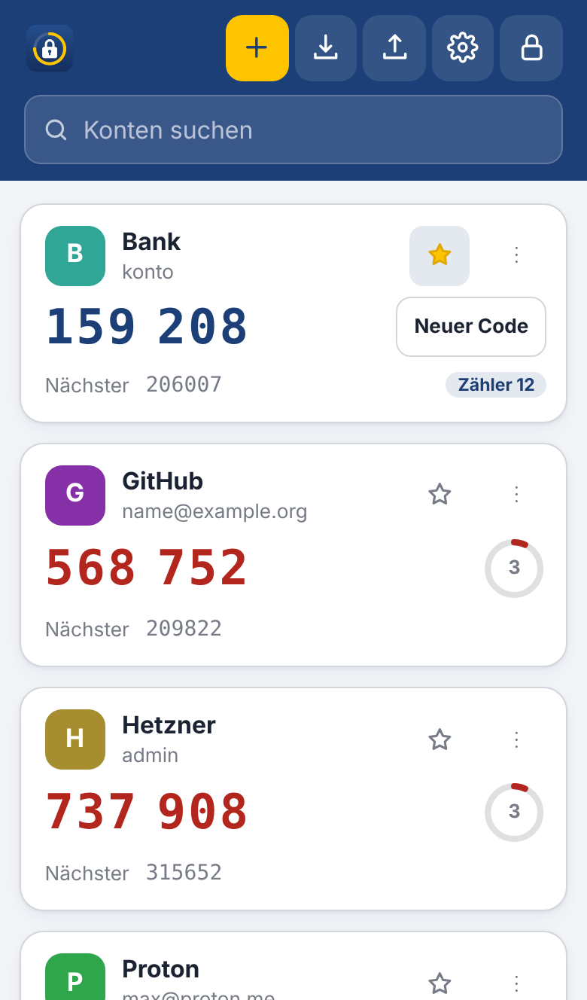
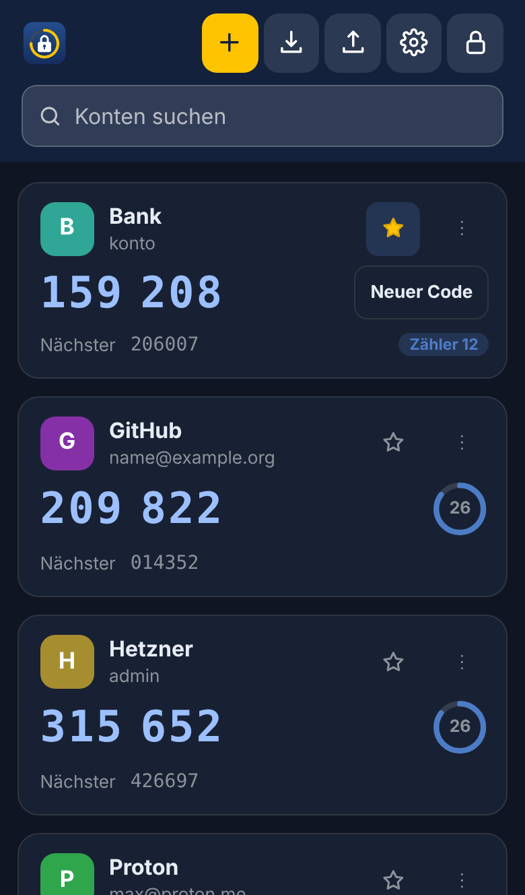
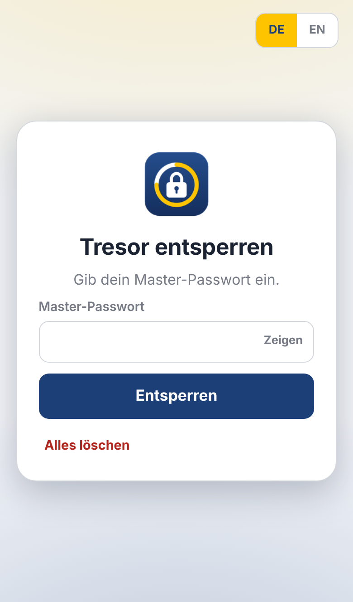
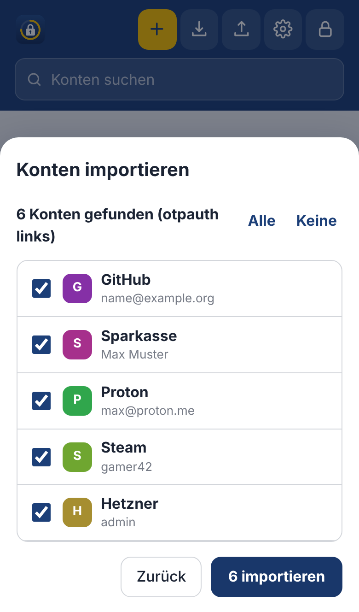
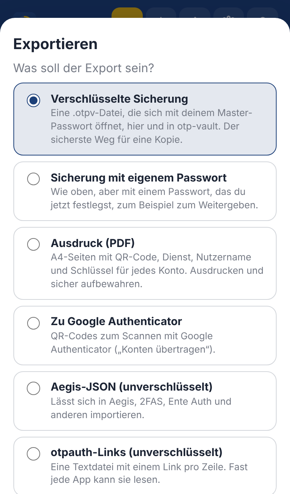
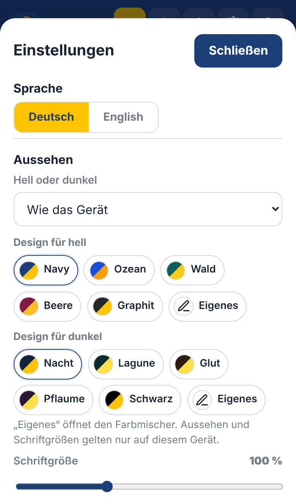

<div align="center">


# OTP-PWA

**Deutsch** · [English](README.en.md)

### Deine Zwei-Faktor-Codes als App aufs Handy, verschlüsselt und ganz auf dem Gerät

**Der kleine Bruder von [otp-vault](https://github.com/burnersen/otp-vault).** Auf dem eigenen Webspace steht nur die Anleitung „So installierst du die App“. Einmal zum Home-Bildschirm hinzugefügt, läuft alles nur noch auf dem Handy, auch ohne Netz. Gleiches Tresor-Format wie otp-vault, gleiche Importe und Exporte, dazu Face ID.

[](#voraussetzungen)
[](#aufs-handy)
[](#lizenz)
[](https://ko-fi.com/burnersen)

**[⬇️ Neuestes Release herunterladen](../../releases/latest)** · **[☕ Spendier mir einen Kaffee](https://ko-fi.com/burnersen)**

 

<sub>Erfundene Beispielkonten.</sub>

</div>

## Inhalt

[Was es kann](#was-es-kann) · [Voraussetzungen](#voraussetzungen) · [Installation](#installation) · [Aufs Handy](#aufs-handy) · [Sichern und Wiederherstellen](#sichern-und-wiederherstellen) · [Bleibt das auf dem Handy?](#bleibt-das-auf-dem-handy) · [Sicherheit](#sicherheit) · [Aktualisieren](#aktualisieren) · [Aufbau](#aufbau) · [Lizenz](#lizenz)

## Was es kann

- **Alle Codes auf einen Blick:** große, gut lesbare Codes mit Countdown-Ring und dem nächsten Code darunter. TOTP, HOTP und Steam, SHA1, SHA256 und SHA512, 6 bis 8 Stellen, jede Gültigkeit. Antippen kopiert.
- **Ganz auf dem Gerät:** der Server liefert nur die App aus, im Browser zeigt die Seite nichts als die Anleitung zum Installieren. Tresor, Schlüssel und Konten verlassen das Handy nie. Es gibt kein Konto, keinen Login und kein Server-Passwort, nur dein Master-Passwort in der App.
- **Face ID oder Fingerabdruck:** auf Wunsch entsperrt Face ID den Tresor. Das ist kein bloßes Häkchen: Face ID gibt über einen Passkey (WebAuthn mit PRF) ein Geheimnis frei, mit dem der Tresor-Schlüssel verschlüsselt ist. Das Master-Passwort geht weiterhin.
- **Importieren aus fast allem:** QR-Codes direkt mit der Kamera (auch mehrere hintereinander für den Google-Export), Bilder und Screenshots, otpauth-Links, ein blanker Schlüssel, Google-Authenticator-Export, Aegis (auch verschlüsselt), 2FAS (auch verschlüsselt), andOTP, Bitwarden (JSON und CSV), KeePassXC-CSV, jede CSV mit Schlüssel-Spalte, Sicherungen von otp-vault. Doppelte werden erkannt.
- **Exportieren in jede Richtung:** verschlüsselte Sicherung (mit dem Master-Passwort oder einem eigenen), A4-Notfallblatt als PDF mit QR-Codes, QR-Codes für Google Authenticator, Aegis-JSON, otpauth-Links, CSV. Auf dem iPhone geht die Datei über „Teilen“ direkt nach „Dateien“, in die iCloud, per AirDrop oder Mail.
- **Gleiches Format wie otp-vault:** eine Sicherung von hier öffnet sich in otp-vault unter Windows und umgekehrt. Das ist mit echtem Go-Code geprüft.
- **Zehn Designs und eigene Farben:** fünf helle, fünf dunkle, dazu je ein eigenes aus dem Farbmischer (Farbton, Sättigung, Helligkeit, Farbwähler oder Farbcode, mit Vorschau). Hell und dunkel wie das Gerät oder fest. Schriftgröße und Größe der Codes einstellbar, kompakte Liste auf Wunsch.
- **Erinnert an Sicherungen:** wenn sich seit der letzten Sicherung etwas geändert hat (Abstand einstellbar).
- **Sperrt sich selbst:** nach einer Weile ohne Benutzung und wenn die App in den Hintergrund geht (beides einstellbar). Beim Verlassen der App werden die Codes unscharf geschaltet.
- **Aktualisiert sich selbst:** der Server holt neue Versionen einmal am Tag aus dem GitHub-Release (mit Prüfsumme), die Handys übernehmen sie nach einem Tipp.
- **Deutsch und Englisch.**

<table>
  <tr>
    <td align="center" width="25%"><br><sub>Entsperren</sub></td>
    <td align="center" width="25%"><br><sub>Import mit Vorschau</sub></td>
    <td align="center" width="25%"><br><sub>Export</sub></td>
    <td align="center" width="25%"><br><sub>Einstellungen</sub></td>
  </tr>
</table>

## Voraussetzungen

- Ein Webspace oder Server mit **PHP 7.4 oder neuer**. Keine Datenbank, keine Erweiterungen nötig.
- **HTTPS mit eigener Domain** (Let's Encrypt reicht). Ohne HTTPS gibt es keine App auf dem Home-Bildschirm, kein Offline und kein Face ID.
- Für automatische Updates zusätzlich: `curl` oder `allow_url_fopen`, und PHP muss die Programmdateien überschreiben dürfen. Fehlt das, läuft alles trotzdem, aktualisiert wird dann von Hand.
- Auf dem Handy: iPhone mit iOS 16.4 oder neuer (Face ID ab iOS 18), Android mit Chrome. Am Rechner geht es in jedem aktuellen Browser.

## Installation

1. Aus dem [neuesten Release](../../releases/latest) die Datei `otp-pwa-install.php` herunterladen und in ein Verzeichnis auf dem Webspace kopieren, zum Beispiel `https://deine-domain.de/otp/`.
2. PHP muss in dieses Verzeichnis schreiben dürfen (es legt dort `index.php` und den Ordner `app/` an, später `data/`).
3. `otp-pwa-install.php` im Browser aufrufen und auf „Jetzt installieren“ tippen. Die Datei packt das Programm aus und löscht sich danach selbst. Meldet sie, dass das nicht ging, bitte von Hand löschen.
4. **Prüfen, dass die internen Ordner gesperrt sind:** `https://deine-domain.de/otp/app/lib/common.php` und `https://deine-domain.de/otp/data/config.php` müssen „403 Forbidden“ oder „404 Not Found“ zeigen. Unter Apache und LiteSpeed erledigen das die mitgelieferten `.htaccess`-Dateien. Unter **nginx** gehören diese Zeilen in den `server`-Block (Pfad anpassen):

```nginx
# OTP-PWA liegt hier im Ordner /otp/. Liegt es direkt im Hauptverzeichnis, /otp weglassen.
location ^~ /otp/data/ { deny all; }
location ^~ /otp/app/  { deny all; }
```

```sh
# Sicherung der Konfiguration (Pfad je nach System)
sudo cp -a /etc/nginx/sites-available/default /etc/nginx/sites-available/default.bak
# Prüfen und neu laden
sudo nginx -t && sudo systemctl reload nginx
# Falls etwas schiefgeht: zurückholen und neu laden
sudo cp -a /etc/nginx/sites-available/default.bak /etc/nginx/sites-available/default && sudo systemctl reload nginx
```

Alles in `app/` liefert OTP-PWA selbst über `index.php` aus, ein direkter Zugriff ist nie nötig. Selbst wenn die Sperre fehlt, liegt dort nichts Geheimes: der Server kennt keine Konten.

> **Plesk und andere Server mit nginx vor Apache:** Ist „Statische Dateien direkt durch nginx bedienen“ an, liefert nginx Dateien wie `.txt`, `.html` oder `.zip` an der `.htaccess` vorbei aus. Dann entweder den Haken rausnehmen oder die nginx-Zeilen oben bei „Zusätzliche nginx-Anweisungen“ eintragen. Test: `https://deine-domain.de/otp/data/index.html` muss „403“ zeigen, nicht eine leere Seite (`data/` entsteht beim ersten Update-Check).

**Lieber von Hand?** Im Release liegt auch `otp-pwa-<Version>.zip`. Den Inhalt des Ordners `otp-pwa/` hochladen, also `index.php` **und** den Ordner `app/`, dann weiter mit Schritt 4.

Ein Passwort für den Server gibt es nicht: die Webseite nimmt nichts an und zeigt im Browser nur die Anleitung zum Installieren.

## Aufs Handy

Im Browser zeigt die Seite nur die Anleitung, passend zum Gerät. Das Programm selbst startet erst als installierte App, so landet der Tresor nie aus Versehen im Browser.

**iPhone:** die Adresse in **Safari** öffnen (nicht im privaten Modus), auf das Teilen-Symbol tippen, dann „Zum Home-Bildschirm“ und „Hinzufügen“. OTP-PWA vom Home-Bildschirm starten.

**Android:** die Adresse in Chrome öffnen, „App installieren“ antippen (oder im Menü „App installieren“).

**Rechner:** in Chrome oder Edge auf das Installieren-Symbol in der Adressleiste klicken, in Safari auf dem Mac „Ablage“ und „Zum Dock hinzufügen“. Firefox kann keine Apps installieren.

Danach: Master-Passwort wählen, Konten hinzufügen (QR-Code mit der Kamera scannen, Link oder Schlüssel einfügen) oder importieren. In den Einstellungen Face ID einschalten.

## Sichern und Wiederherstellen

**Sichern:** *Exportieren* → „Verschlüsselte Sicherung“ → „Datei erstellen“ → „Teilen oder in Dateien sichern“. Die `.otpv`-Datei ist mit deinem Master-Passwort verschlüsselt (Argon2id und XChaCha20-Poly1305), genau wie bei otp-vault. Sie gehört trotzdem an einen sicheren Ort, etwa iCloud Drive oder einen USB-Stick. Die App erinnert dich, wenn eine neue Sicherung fällig ist.

**Wiederherstellen auf einem neuen Gerät:** die Seite aufrufen, als App installieren, auf dem Sperrbildschirm „Aus Sicherung wiederherstellen“ tippen, die `.otpv`-Datei wählen und ihr Passwort eingeben. Fertig. Das Passwort der Sicherung ist danach dein Master-Passwort, ändern lässt es sich in den Einstellungen.

**Zusätzlich in einen bestehenden Tresor:** *Importieren* → Datei wählen. Das klappt mit Sicherungen von OTP-PWA und otp-vault genauso wie mit den Exporten anderer Apps.

**Auf Papier:** das PDF-Notfallblatt enthält pro Konto QR-Code, Dienst, Nutzername und Schlüssel. Ausdrucken, sicher aufbewahren, Datei löschen.

## Bleibt das auf dem Handy?

Ja. Eine App auf dem Home-Bildschirm behält ihre Daten, abgemeldet wird man nicht (es gibt ja kein Konto). Die Regel von Safari, Daten nach sieben Tagen ohne Besuch zu löschen, gilt für Apps vom Home-Bildschirm nicht. OTP-PWA bittet den Browser außerdem um dauerhaften Speicher, in den Einstellungen unter *Speicher* steht, ob das geklappt hat.

Weg sind die Daten aber, wenn du die App vom Home-Bildschirm löschst, „Website-Daten löschen“ wählst oder das Gerät bei extremem Platzmangel aufräumt. **Deshalb: regelmäßig sichern.** Fällt der Server einmal aus, läuft die App auf dem Handy einfach weiter.

## Sicherheit

- Der Tresor liegt verschlüsselt im Speicher des Browsers (IndexedDB), im Dateiformat von otp-vault: Schlüssel aus dem Master-Passwort mit **Argon2id** (64 MiB, 3 Durchläufe), Inhalt mit **XChaCha20-Poly1305**, der Kopf ist an den Inhalt gebunden. Ohne Passwort ist nichts lesbar, auch nicht die Namen der Konten. Der vorige Stand bleibt als Rückfall liegen.
- Entsperrt sind Schlüssel und Konten nur im Arbeitsspeicher. Sperren vergisst beides.
- **Face ID:** ein Passkey auf dem Gerät liefert nach Face ID über die WebAuthn-Erweiterung PRF ein Geheimnis. Daraus entsteht ein Schlüssel, mit dem der Tresor-Schlüssel verschlüsselt gespeichert wird. Ohne Face ID kommt niemand daran. Nach einer Passwortänderung muss Face ID neu eingeschaltet werden.
- Die App lädt nichts von fremden Servern und schickt nichts weg (strenge Content-Security-Policy, `connect-src 'self'`). Die einzige Verbindung geht zum eigenen Server, um nach einer neuen Version zu sehen.
- **Was du dem Server zutrauen musst:** er liefert den Programmcode. Wer den Server übernimmt, könnte eine veränderte App ausliefern. Deshalb wechseln die Handys erst nach einem Tipp auf „Aktualisieren“ auf eine neue Version, und der Server spielt nur Releases ein, deren Prüfsumme stimmt. Halte den Webspace sicher (Updates des Hosters, starke Passwörter).
- Die Zwischenablage wird nach der eingestellten Zeit geleert, sofern das Gerät es zulässt. Das iPhone erlaubt das oft nicht.

## Aktualisieren

**Von selbst:** einmal am Tag sieht der Server im GitHub-Release nach (angestoßen, wenn eine App nach einer neuen Version fragt). Gibt es eine neue, lädt er den Installer, prüft ihn per Prüfsumme und spielt ihn ein. Ein Knopf oder Passwort ist dafür nicht nötig. Ob es geklappt hat, steht in der App unter *Einstellungen → Über*.

Die Handys merken die neue Version beim nächsten Öffnen der App und zeigen „Neue Version bereit“. Ein Tipp auf „Aktualisieren“ lädt sie, danach kurz neu entsperren. Der Tresor bleibt dabei unangetastet.

**Von Hand:** den neuen `otp-pwa-install.php` hochladen und aufrufen. Ersetzt werden nur die Programmdateien. Genauso kommst du zu einer älteren Version zurück: deren Installer aus dem Release hochladen und aufrufen.

Updates ganz abschalten: in `data/config.php` den Eintrag `'update_url' => ''` ergänzen (sonst kommt am nächsten Tag wieder die neueste Version).

## Aufbau

```
index.php      Einstieg: liefert App, Dateien, Service Worker und Manifest aus (PHP)
app/lib/       Hilfen und automatische Updates aus dem GitHub-Release (PHP)
app/views/     die App-Seite (im Browser nur die Anleitung, als App das Programm)
app/assets/    die App im Browser: core.js (Codes, Formate, Tresor, PDF), app.js (Oberfläche), i18n.js (Texte),
               app.css, sw.js (Service Worker), Bibliotheken (Argon2, XChaCha20, QR-Codes)
data/          entsteht auf dem Server, nur für den Stand der Updates
tools/         Prüfungen (node tools/check.js) und Release-Bau (php tools/build-release.php)
```

Kein Framework, kein npm, kein Build-Schritt: was im Repo liegt, läuft. Prüfen:

```sh
node tools/check.js
for f in index.php app/lib/*.php app/views/*.php tools/*.php; do php -l "$f"; done
php tools/build-release.php
```

## ☕ Unterstützen

OTP-PWA ist kostenlos und entsteht in meiner Freizeit. Wenn es dir Zeit gespart hat, kannst du [ein kleines Trinkgeld bei Ko-fi dalassen](https://ko-fi.com/burnersen). Völlig freiwillig, und in jedem Fall: danke fürs Benutzen!

## Lizenz

GNU General Public License v3.0, siehe [LICENSE](LICENSE). Mitgeliefert: [hash-wasm](https://github.com/Daninet/hash-wasm), [@noble/ciphers und @noble/hashes](https://paulmillr.com/noble/), [qrcode-generator](https://github.com/kazuhikoarase/qrcode-generator) (alle MIT) und [jsQR](https://github.com/cozmo/jsQR) (Apache-2.0), siehe `app/assets/THIRD-PARTY-LICENSES.txt`.
